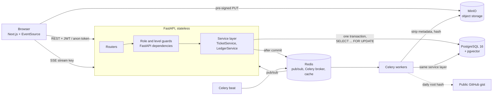
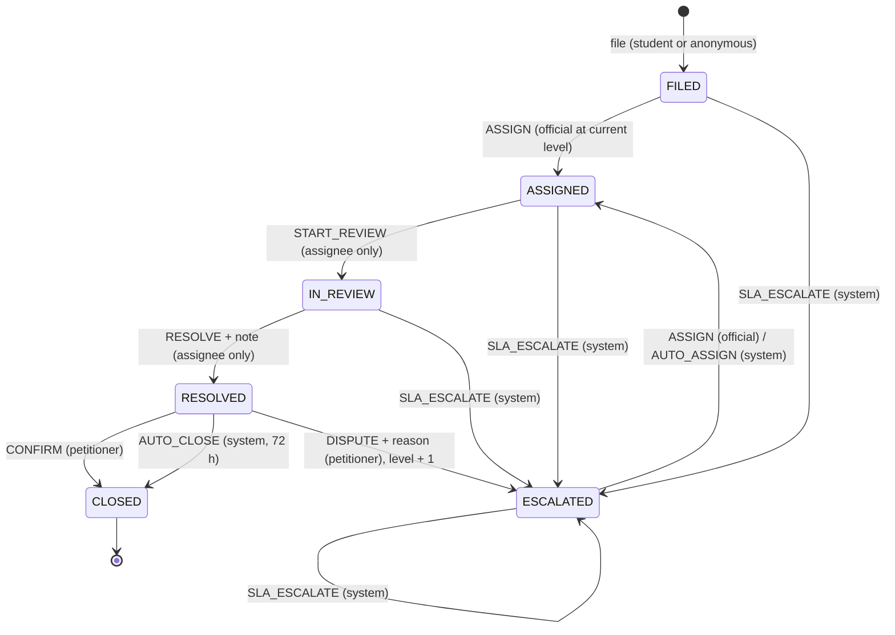

# The Vishanti

Tamper-evident grievance redressal for a college campus. Webster 2026, problem statement E3, team 404Found (ID 148).

A complaint enters a strict state machine and its own SHA-256 hash chain. An SLA clock starts the moment it is filed. If the responsible official misses the deadline, a background worker moves it to the next authority (Warden → Dean → Registrar → external ombudsperson). Every view by an official is logged, every step is sealed, and anonymised statistics are published on a public dashboard with small-count suppression.

| | |
|---|---|
| Backend | FastAPI, async SQLAlchemy, PostgreSQL 16 + pgvector, Celery + Redis, SSE |
| Frontend | Next.js 16 (App Router), React 19, plain CSS |
| Tests | 74 automated tests against real Postgres and Redis (`backend/tests`) |
| Docs | [Escalation verification report](docs/ESCALATION_VERIFICATION.md), [Viva demo script](docs/DEMO.md) |

---

## Contents

1. [Run it](#run-it)
2. [Architecture](#architecture)
3. [State machine](#state-machine)
4. [Audit trail and how it is verified](#audit-trail-and-how-it-is-verified)
5. [SLA escalation](#sla-escalation)
6. [Anonymity](#anonymity)
7. [Real-time notifications](#real-time-notifications)
8. [Duplicate clustering](#duplicate-clustering)
9. [Public transparency ledger](#public-transparency-ledger)
10. [Failure modes](#failure-modes)
11. [Measured performance](#measured-performance)
12. [Tests](#tests)
13. [Scope: built vs designed](#scope-built-vs-designed)
14. [Tool disclosure](#tool-disclosure)

---

## Run it

### With Docker (everything)

```bash
docker compose up --build
```

| Service | URL |
|---|---|
| Web app | http://localhost:3000 |
| API docs (OpenAPI) | http://localhost:8000/docs |
| MinIO console | http://localhost:9001 (`vishanti` / `vishanti-secret`) |

`migrate` creates the schema, the database guards, the escalation rules, demo accounts and about 90 synthetic demo complaints (filed through the real services, so every one has a valid chain). By default `SLA_HOUR_SECONDS=60`, so one SLA hour lasts one minute and escalation can be watched live. Use `3600` for real deadlines.

### Without Docker

Needs PostgreSQL 16 with the `vector` extension, and Redis 7.

```bash
# backend
cd backend
python -m venv .venv && . .venv/bin/activate
pip install -r requirements-dev.txt        # add requirements-ml.txt for the real embedding model
cp .env.example .env                        # set DATABASE_URL etc.
python -m app.init_db --demo
uvicorn app.main:app --port 8000 --no-access-log
celery -A app.celery_app worker -B --loglevel=INFO   # second terminal

# frontend
cd frontend
npm install
NEXT_PUBLIC_API_URL=http://localhost:8000 npm run dev
```

### Demo accounts

All passwords are `vishanti123`. The sign-in page can fill them in.

| Role | Email |
|---|---|
| Student | `student1@vishanti.edu`, `student2@…`, `student3@…` |
| Warden (L1, Hostel) | `warden@vishanti.edu` |
| Dean of Students (L2) | `dean.of.students@vishanti.edu` |
| Registrar (L3) | `registrar@vishanti.edu` |
| Other officials | `<designation with dots>@vishanti.edu`, e.g. `mess.manager@`, `it.cell.head@`, `bursar@` |
| Administrator | `admin@vishanti.edu` |

---

## Architecture



**Request path when a student files a complaint**

1. Rate limit (SlowAPI, key = HMAC of the IP, never stored raw), Pydantic validation, JWT or anonymous-token dependency, `Idempotency-Key` header.
2. One Postgres transaction: insert the ticket in `FILED`, compute `due_at` from the escalation rule and priority, append the `GENESIS` entry (which commits to the complaint text and attachment hashes), store notifications.
3. After commit only: publish to Redis, queue the Celery ETA task for the deadline, queue the embedding task. (`app/services/events.py`. If the transaction rolls back, nothing leaks.)
4. The SSE hub pushes the event to the petitioner and the official's queue.
5. A worker embeds the text locally and assigns it to a cluster in pgvector.
6. The public dashboard is recomputed by a background task and served from a Redis cache, so public traffic never touches the write path.

**Code map**

```
backend/app
  services/tickets.py      state machine: create, transition, guards (FOR UPDATE)
  services/ledger.py       hash chain, verifier, checkpoints
  services/escalation.py   ETA task logic, sweeper (SKIP LOCKED), warnings, auto-close
  services/events.py       post-commit side effects
  services/storage.py      pre-signed upload, metadata stripping, hashing
  services/embeddings.py   local embeddings, sentiment, clustering
  services/dashboard.py    aggregates and suppression
  schema_sql.py            append-only triggers, constraints, least-privilege grants
  routers/*                HTTP; stream.py is the SSE hub
  worker.py, celery_app.py background tasks and schedule
frontend/src
  components/Record.tsx    chain view + in-browser verification
  lib/verify.ts            canonical JSON + WebCrypto SHA-256 (mirrors the backend)
```

---

## State machine

The transitions live in the `transition_rules` table, not in `if` statements. A transition is allowed only if a row matches `(current status, action, actor kind)`.



Guards on every official action: the user's `level` must equal the ticket's `current_level`, and their designation must be the one the escalation rule names for that category and level. `START_REVIEW` and `RESOLVE` also require being the assignee. System actions (`SLA_ESCALATE`, `AUTO_ASSIGN`, `AUTO_CLOSE`) cannot be requested over HTTP at all (the request schema rejects them).

**Why the petitioner confirms.** If an official could close a ticket, closing early would stop the clock. Here `RESOLVED` only pauses it; the petitioner confirms or disputes within 72 SLA hours, and a dispute reopens the ticket one level up.

**Concurrency.** Every transition runs in one transaction that starts with `SELECT … FOR UPDATE` on the ticket row, re-reads the status inside the lock, checks the rule, applies it and appends to the chain. Two officials picking up the same ticket: one wins, the other gets `409` because the status is no longer `FILED` (tested with 5 officials in parallel). Unrelated tickets never block each other.

---

## Audit trail and how it is verified

Each ticket has its own chain in `ledger_entries`:

```
payload_hash = SHA-256( canonical_json(payload) )
hash         = SHA-256( canonical_json({
                 "v": 1, "ticket_id", "seq", "prev_hash",
                 "actor", "action", "payload_hash", "ts" }) )
```

* **Canonical JSON**: keys sorted, no whitespace, UTF-8, floats refused (different languages print floats differently). The timestamp is stored as the exact fixed-width string that was hashed (`2026-10-22T11:49:36.626868Z`), so reading it back from the database can never change it.
* **Entry 0** is `GENESIS` with `prev_hash` = 64 zeros. Its payload includes `content_sha256` (title, description, category, priority) and the SHA-256 of every attachment.
* `UNIQUE (ticket_id, seq)` makes a forked chain impossible even if a lock were missed.

**Database guards** (`app/schema_sql.py`)

* A trigger rejects `UPDATE`, `DELETE` and `TRUNCATE` on `ledger_entries`, `checkpoints` and `access_logs`.
* The API and workers connect as `vishanti_app`, which does not own the tables (so it cannot disable the trigger) and has those privileges revoked.

**What the verifier checks** (`ledger.verify_ticket`), in order, reporting the first failure with its entry number:

| Check | Catches |
|---|---|
| `seq` is 0, 1, 2… with no gaps | deleted or reordered entry |
| `prev_hash` equals the previous `hash` | spliced entry |
| `payload_hash` recomputes | edited payload (e.g. a rewritten comment) |
| `hash` recomputes | edited actor, action or timestamp |
| ticket's `head_hash` equals the last entry | deleted newest entries |
| replaying statuses and levels gives the ticket row | `UPDATE tickets SET status='CLOSED'` behind the ledger's back |
| GENESIS `content_sha256` matches the ticket | edited complaint text |
| attachment hashes match GENESIS | swapped attachment |

The verifier runs every 5 minutes (Celery beat). New failures create a `tamper_alerts` row and a live "Tamper Detected" notification to admins.

**Verification in the browser.** The complaint page's "Verify record" button recomputes every seal with WebCrypto (`frontend/src/lib/verify.ts`, a line-for-line mirror of the Python canonical form), animating down the chain, and then shows the server's deeper checks. The petitioner does not have to trust our server's word.

**Threat model, honestly.** We claim tamper-evidence, not tamper-proofing. Someone with full control of the database server could rewrite a whole chain consistently. Daily checkpoints limit that: a checkpoint is SHA-256 over every chain head plus the previous checkpoint, so checkpoints form their own chain, and each one can be published to a public GitHub gist (`GITHUB_TOKEN`, `CHECKPOINT_GIST_ID`) whose revision history we do not control. Any rewrite of history before a published checkpoint no longer matches it. `test_full_chain_rewrite_is_caught_by_checkpoint` performs exactly this attack (recomputing every later hash) and shows the chain check is fooled while the checkpoint check is not.

---

## SLA escalation

Deadline = `base_sla_hours(category, level) × priority scale × SLA_HOUR_SECONDS`, with priority scales critical 0.25, high 0.5, medium 1, low 1.5. Rules are rows in `escalation_rules` and are edited in the admin panel without a redeploy (every change is logged with before/after).

Default ladder (excerpt):

| Category | Level 1 | Level 2 | Level 3 |
|---|---|---|---|
| Hostel | Warden, 48 h | Dean of Students, 72 h | Registrar, 96 h |
| Mess | Mess Manager, 24 h | Dean of Students, 48 h | Registrar, 72 h |
| Fees & Finance | Bursar, 72 h | Finance Officer, 96 h | Registrar, 120 h |
| IT & Network | IT Cell Head, 24 h | Dean Planning, 48 h | Registrar, 72 h |
| Safety & Harassment | ICC Chairperson, 24 h | Dean of Students, 24 h | Registrar, 24 h |

Two independent mechanisms call one idempotent function, `escalate_if_due`:

1. **ETA task.** After every commit that starts a timer, a Celery task is queued with `eta = due_at` and the expected deadline as an argument.
2. **Sweeper.** Every minute, Celery beat runs a sweep that takes overdue tickets one per transaction with `FOR UPDATE SKIP LOCKED`, so parallel sweepers split the work and a failure on one ticket does not roll back others.

`escalate_if_due` re-reads the ticket under lock and acts only if it is still open, past its deadline, and (for ETA tasks) still on the same deadline. After escalation `due_at` moves forward, so a duplicate or late task does nothing. Postgres `due_at` is the source of truth; Redis (with AOF) only makes it fast. If Redis loses a task, the sweeper still escalates within a minute.

On escalation the ticket goes to the next level, gets a fresh timer, and is routed to the least-loaded official holding that designation (`ESCALATED → ASSIGNED`, recorded as `system:router`). At the top level a breach records an `OMBUDSPERSON_ALERT` entry, notifies admins and the petitioner, and lists the ticket on the public record. "SLA breach in X minutes" warnings go out when 20 % of a timer remains.

Celery note: with a Redis broker, unacknowledged ETA tasks are redelivered after `visibility_timeout`. We set it to 8 days; idempotency makes redelivery harmless anyway.

Full evidence: [docs/ESCALATION_VERIFICATION.md](docs/ESCALATION_VERIFICATION.md).

---

## Anonymity

* Anonymous mode drops identity even if the student is signed in (the frontend also sends no session with the request).
* The server generates a 256-bit token (`secrets.token_urlsafe(32)`), returns it once and stores only `SHA-256(token)`. A database leak does not reveal usable tokens.
* The ledger records the actor as `petitioner:anonymous`. A test asserts the student's id appears nowhere in an anonymous ticket's chain.
* Attachments are re-encoded server-side, removing EXIF (including GPS), XMP and PDF author metadata. A test uploads a JPEG with a GPS tag and camera make and checks both are gone.
* No IP logging: uvicorn's access log is off; our request log has method, path, status and time only. Rate-limit keys are HMAC(secret, day, IP).
* Retry safety: an idempotency replay cache (Redis, 15 minutes) returns the same token if the first response was lost. This is the only place the raw token exists outside the browser, briefly.

---

## Real-time notifications

Server-Sent Events, because updates only flow server → client and SSE reconnects natively over plain HTTP.

* `EventSource` cannot send headers, and a JWT or anonymous token in a URL would leak into logs. So the client POSTs with its normal credentials to `/api/stream/key` and gets a 10-minute key that maps only to its channels (`user:<id>`, `queue:<designation>`, `admin`, or `anon:<token hash>`).
* Every notification is a Postgres row whose bigint id is the SSE event id. On reconnect the client sends `last_event_id`; the hub subscribes to Redis first, replays missed rows, then streams live messages, dropping ids it already sent. `test_live_events_and_replay` starts a real server, disconnects, makes two changes, reconnects and receives exactly those two.

---

## Duplicate clustering

A Celery worker embeds each complaint locally with `all-MiniLM-L6-v2` (384-d) and scores sentiment with a small Hugging Face model, so complaint text never leaves our server. The vector is stored in pgvector and compared by cosine distance (`<=>`) with cluster centroids in the same category; within 0.30 it joins (centroid updated), otherwise it starts a new cluster. At 3 members, admins and the level-1 official get a "systemic issue" alert. Officials see clusters on their desk; the public sees only category and size for clusters of 5+.

If the model is not installed, `EMBEDDINGS_BACKEND=auto` falls back to signed feature hashing of words and word pairs. That keeps the pipeline and tests running but only matches shared words: it will not group "Wi-Fi down" with "internet not working". The admin panel shows which backend is active. The Docker image installs and pre-downloads the real models.

---

## Public transparency ledger

`/record` is server-rendered from cached aggregates: complaints per category per month, share finished without missing a deadline, median time to resolution, open complaints by level, top-level breaches, recurring problems, and the daily seals.

Any cell with 1–4 cases is shown as "hidden". If a row would have exactly one hidden cell, the next-smallest cell is hidden too, so the value cannot be recovered by subtraction from a total.

---

## Failure modes

| What fails | What happens |
|---|---|
| Redis down | Tickets and notifications are still committed to Postgres. Publishing and task queueing log a warning. The sweeper escalates from `due_at` once workers run again; SSE clients replay missed events by id. |
| Worker crashes mid-task | `acks_late` + `reject_on_worker_lost`: the task is redelivered; idempotent escalation makes the retry safe. |
| Two workers fire on the same ticket | Row lock serialises them; the second finds "not due" or "stale". `test_parallel_workers_escalate_once`. |
| Client retries after a timeout | `Idempotency-Key` unique constraint plus replay cache: same ticket, same token. |
| Petitioner's connection drops | SSE reconnect with `last_event_id` replays from Postgres. |
| Embedding model missing or slow | Only clustering is delayed or degraded; filing is unaffected. |
| An insider edits the database | Detected by the scheduled verifier and the in-browser check; full rewrites are caught by published checkpoints. |
| No official holds the next designation | The ticket stays `ESCALATED` in that level's queue with its timer running, so it keeps climbing. |

---

## Measured performance

`python -m scripts.bench --tickets 2000 --api http://localhost:8100` on a 2-vCPU, 8 GB sandbox, with Postgres, Redis, a 2-worker API and the load generator all on the same machine:

| Measurement | Result |
|---|---|
| Filing through the service layer, 16 concurrent writers | 2,000 tickets in 12.0 s (166 / s) |
| 2,000 overdue tickets escalated by 3 parallel sweepers | 24.7 s (81 / s); split 668 / 667 / 665; **0 tickets escalated twice** |
| Full ledger verification | 2,000 chains, 6,000 entries in 3.3 s (1,835 entries / s) |
| HTTP filing, 300 requests, 16 concurrent | p50 187 ms, p95 610 ms |
| ETA escalation precision (live run, Celery + Redis) | fired 3 ms after the deadline |

---

## Tests

```bash
cd backend
pytest            # needs Postgres with pgvector and Redis; see tests/conftest.py
```

74 pass, 1 is skipped unless the real embedding model is installed. They run against real Postgres because the properties under test (row locks, `SKIP LOCKED`, triggers, unique constraints) are database behaviour.

| File | Covers |
|---|---|
| `test_state_machine.py` | full lifecycle, no skipped states, level/designation/assignee guards, disputes, ombudsperson, anonymity, priority scaling |
| `test_ledger.py` | canonical form, append-only trigger, eight tamper scenarios, alerts, checkpoint chain, full-rewrite attack |
| `test_escalation.py` | ETA task queued at `due_at`, stale/duplicate tasks, unassigned tickets escalate, full ladder, sweeper idempotency, parallel sweepers, auto-close, warnings, rule changes, the real Celery task body |
| `test_concurrency.py` | 5 officials racing, 20 parallel comments, resolve-vs-escalate race |
| `test_api.py` | auth, idempotent filing, anonymous tracking, access log, metadata stripping, fake file types, role checks |
| `test_clustering_and_dashboard.py` | clustering and systemic alert, suppression rules |
| `test_sse_e2e.py` | live delivery and replay over a real server |

Demo of tampering for the viva: `python -m scripts.tamper_demo VSH-000002` (see [docs/DEMO.md](docs/DEMO.md)).

---

## Scope: built vs designed

**Built and demonstrated:** intake with anonymous mode and attachments, state machine with role guards, per-ticket hash chain with scheduled verifier and in-browser verification, append-only enforcement, daily checkpoints (gist anchoring optional), SLA worker with ETA tasks + sweeper + warnings + auto-close, ombudsperson flag, SSE with replay, official access logging, public dashboard with suppression, duplicate clustering, admin rules editor.

**Designed for, not deployed:** load balancer, read replica (`READ_DATABASE_URL` is supported and used by the dashboard; defaults to the primary), PgBouncer (`USE_PGBOUNCER=true` disables asyncpg statement caching for transaction pooling), and real delivery to an external ombudsperson (we record and publish the alert; sending e-mail is not wired up).

**Differences from the abstract worth knowing:**
* Attachments are uploaded with pre-signed URLs to a quarantine prefix, then finalised by the server (type check, metadata removal, hashing) before the ticket is filed, so the GENESIS entry can include the clean files' hashes.
* After an escalation the system auto-assigns the least-loaded official at the new level (the abstract left the assignee open).
* The browser-side verification and the restricted database role were added on top of the abstract.

---

## Tool disclosure

| Tool | Used for | Licence |
|---|---|---|
| FastAPI, Starlette, Pydantic, pydantic-settings | API, validation, settings | MIT |
| SQLAlchemy 2 (async), asyncpg, greenlet | database access | MIT / Apache-2.0 |
| PostgreSQL 16, pgvector | storage, row locks, triggers, vector search | PostgreSQL |
| Celery, Redis, redis-py | ETA tasks, beat schedule, pub/sub, cache | BSD |
| sse-starlette | SSE responses | BSD-3 |
| PyJWT, passlib, bcrypt | tokens, password hashing | MIT / BSD / Apache-2.0 |
| SlowAPI | rate limiting | MIT |
| Pillow, pypdf | metadata stripping | MIT-CMU / BSD |
| boto3, MinIO | object storage | Apache-2.0 / AGPLv3 |
| sentence-transformers, transformers, PyTorch (CPU) | local embeddings and sentiment | Apache-2.0 / BSD |
| NumPy, httpx | vectors, HTTP client | BSD |
| Next.js, React | frontend | MIT |
| Schibsted Grotesk, JetBrains Mono (via Fontsource) | type | OFL |
| pytest, pytest-asyncio, ruff | tests, lint | MIT |
| Docker, docker compose | packaging | Apache-2.0 |
| **Claude (Anthropic), AI assistant** | generated the initial implementation of this repository from our abstract and design decisions: backend, frontend, tests, benchmark script and documentation. | n/a |
